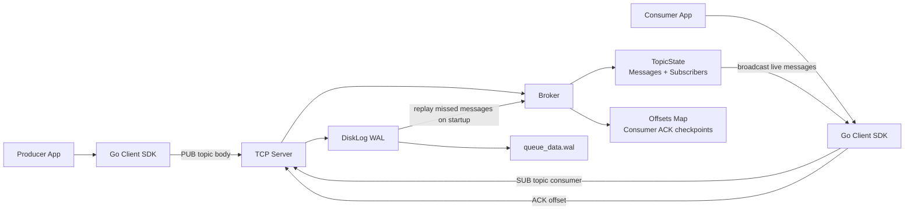

# Message Queue in Go

A lightweight, topic-based message queue built in Go to explore the core ideas behind real-world messaging systems: in-memory pub/sub routing, durable write-ahead logging, replay behavior, and a simple TCP-based network interface.

This project follows the learning progression from the three implementation phases:

- Phase 1: in-memory broker with topics and subscriber channels
- Phase 2: WAL persistence with recovery and log compaction
- Phase 3: network server, command protocol, and client SDK

## Overview

The queue supports:

- Topic-based message publishing
- Multiple subscribers per topic
- Durable consumer offsets and replay of unacknowledged messages
- Crash-safe persistence to a local WAL file
- A minimal TCP server protocol for external producers and consumers

The current implementation is intentionally small and practical, making it a good reference for understanding how a basic queue can be structured without bringing in a full framework or external dependency.

## Architecture



## Project Structure

```text
Message-Queue/
├── README.md
├── messagequeue/
│   ├── Dockerfile
│   ├── go.mod
│   ├── queue_data.wal
│   ├── Phase1.md
│   ├── Phase2.md
│   ├── Phase3.md
│   ├── cmd/
│   │   ├── consumer/
│   │   │   └── main.go
│   │   ├── producer/
│   │   │   └── main.go
│   │   └── server/
│   │       ├── main.go
│   │       └── server.go
│   ├── internal/
│   │   └── broker/
│   │       ├── broker.go
│   │       └── wal.go
│   └── pkg/
│       ├── client/
│       │   └── client.go
│       └── protocol/
│           └── commands.go
└── ...
```

## Phase-by-Phase Summary

### Phase 1: Core Broker and Pub/Sub Engine

The first phase establishes the in-memory message broker.

Key ideas from the implementation:

- A `Broker` stores topics in a thread-safe map.
- Each topic maintains a slice of subscriber channels and a message history.
- `PublishAssign` assigns a monotonically increasing offset and broadcasts each message to subscribers.
- `SubscribeDurable` allows a consumer to latch onto a topic and replay historical messages that happened before it joined.
- The broker uses locking patterns to avoid data races while allowing concurrent publishing and subscription management.

This phase is implemented in:

- `messagequeue/internal/broker/broker.go`

### Phase 2: Persistence with Write-Ahead Log

The second phase adds crash resilience.

The queue persists each message to a disk log in a structured binary format:

- 8 bytes: message offset
- 4 bytes: topic length
- 4 bytes: body length
- topic bytes
- body bytes

This is handled by the `DiskLog` implementation in:

- `messagequeue/internal/broker/wal.go`

It provides:

- `Append` for writing new messages
- `ReadAll` for recovery after a restart
- `Compact` to garbage-collect acknowledged messages based on the minimum consumer offset

This gives the queue the ability to recover in-memory topic state after a restart without losing the message history that has not yet been fully processed.

### Phase 3: Network Server and Protocol

The third phase exposes the broker over TCP so external producers and consumers can connect to it.

Supported commands:

```text
PUB <topic> <body>
SUB <topic> <consumer_name>
ACK <consumer_name> <offset>
```

Examples:

```text
PUB iot_metrics Temperature=22.4
SUB iot_metrics analytics_worker_node
ACK analytics_worker_node 42
```

Relevant parts:

- `messagequeue/pkg/protocol/commands.go` parses incoming commands
- `messagequeue/cmd/server/server.go` handles accepted client connections
- `messagequeue/pkg/client/client.go` provides a simple SDK for publishing and subscribing

The server listens on port `9099` by default.

## Local Run Instructions

From the project directory:

```bash
cd Message-Queue/messagequeue
```

Install and fetch dependencies:

```bash
go mod tidy
```

### Start the server

In one terminal:

```bash
go run ./cmd/server
```

You should see output similar to:

```text
[Server] Message queue live on 0.0.0.0:9099
```

The server will create and use a local WAL file named `queue_data.wal` in the project root.

### Run a producer

Open a second terminal and run:

```bash
go run ./cmd/producer
```

This sends sample payloads to the `iot_metrics` topic.

### Run a consumer

Open a third terminal and run:

```bash
go run ./cmd/consumer
```

The consumer subscribes to `iot_metrics` and prints incoming messages from the stream.

## Example Interaction Flow

```text
Producer -> Server: PUB iot_metrics Sensor-Data-Telemetry-TelemetryPayload-25
Server -> Broker: assign offset, broadcast to subscribers
Server -> WAL: append message to queue_data.wal
Consumer -> Server: SUB iot_metrics analytics_worker_node
Server -> Consumer: stream live message payloads
Consumer -> Server: ACK analytics_worker_node 1
Server -> Broker: record consumer checkpoint
```

## Notes on Behavior

- The consumer receives live messages after subscription and can replay historical messages that were published before it connected.
- Acknowledgements allow the broker to track how far each consumer has processed the topic stream.
- The WAL helps the queue recover state after a restart.
- The compaction loop removes acknowledged records from the WAL once they are no longer needed.

## Docker Option

A `Dockerfile` is included for building a containerized server image.

Build:

```bash
docker build -t message-queue .
```

Run:

```bash
docker run --rm -p 9099:9099 message-queue
```

## Key Implementation Files

- `messagequeue/cmd/server/main.go` — server startup and WAL recovery
- `messagequeue/cmd/server/server.go` — TCP client handling
- `messagequeue/internal/broker/broker.go` — message routing and subscriptions
- `messagequeue/internal/broker/wal.go` — persistence and compaction
- `messagequeue/pkg/protocol/commands.go` — protocol parsing
- `messagequeue/pkg/client/client.go` — client SDK for producers/consumers

## Learnings From the Project

This queue is a good starting point for understanding how core messaging infrastructure works:

- message ownership is separated from delivery
- offsets create a simple checkpoint model
- durable storage protects against failures
- a basic TCP protocol can be enough for internal service communication
- a broker can be intentionally small but still teach important distributed-system concepts

## Next Improvements

A natural next step would be to add:

- persistent consumer group state
- retry and dead-letter queues
- topic retention policies
- TLS support for secure connections
- richer CLI tooling and health checks

